# Fair Price Checker 🚗⚡

<p align="center">
  
</p>

> **Production-Grade Machine Learning System for Indian Pre-Owned Vehicle Valuation**  
> Estimate accurate market value, quantify uncertainty with tree-ensemble fair ranges (P10–P90), and detect whether a seller's asking price is a **Good Deal**, **Fair**, or **Overpriced**.

[](https://fastapi.tiangolo.com)
[](https://scikit-learn.org)
[](https://react.dev)
[](https://vitejs.dev)
[](https://tailwindcss.com)
[](https://python.org)
[](backend/tests/test_api.py)
[](LICENSE)

---

## 📑 Table of Contents
- [Executive Overview](#-executive-overview)
- [Key Features](#-key-features)
- [Application Preview & Screenshots](#-application-preview--screenshots)
- [Machine Learning Pipeline & Methodology](#-machine-learning-pipeline--methodology)
- [Minute-Level Model Evaluation & Results](#-minute-level-model-evaluation--results)
- [Exploratory Data Analysis (EDA) Figures](#-exploratory-data-analysis-eda-figures)
- [System Architecture](#-system-architecture)
- [API Reference](#-api-reference)
- [Project Directory Structure](#-project-directory-structure)
- [Local Setup & Installation](#-local-setup--installation)
- [Automated Testing & Verification](#-automated-testing--verification)
- [Limitations & Ethical Boundaries](#-limitations--ethical-boundaries)
- [Viva & Technical Interview Guide](#-viva--technical-interview-guide)

---

## 🌟 Executive Overview

The Indian pre-owned automobile market is fraught with severe information asymmetry:
1. **Unregulated Asking Prices**: Sellers arbitrarily mark up prices based on optimism rather than market depreciation curves.
2. **Non-Linear Depreciation**: Vehicles lose up to 35–40% of their value within the first 4 years before price decay plateaus. Linear formulas consistently misprice young cars.
3. **Complex Feature Interactions**: Engine displacement ($cc$), power output ($bhp$), fuel economics, and odometer distance interact in intricate, non-additive ways.

**Fair Price Checker** solves this by combining a **150-tree Random Forest regressor** with a high-performance **FastAPI backend** and a modern **React 18 frontend**. Rather than providing a single point prediction, it evaluates individual decision trees to generate a calibrated **P10–P90 Fair Price Range**, quantifying pricing ambiguity and arming Indian car buyers with actionable negotiation data.

---

## ✨ Key Features

- **Automated Valuation Engine**: $R^2 = 0.9332$ on held-out test data, capturing 93.3% of market variance with a median absolute percentage error of just **9.59%**.
- **P10–P90 Fair Valuation Band**: Computes the 10th and 90th percentiles of tree predictions to quantify model disagreement (narrow, moderate, or wide uncertainty).
- **Three-Tier Negotiation Verdicts**:
  - 🟢 **Good Deal**: Asking price below P10 ($\ge 5\%$ below market value).
  - 🔵 **Fair Price**: Asking price nestled safely inside the P10–P90 band.
  - 🔴 **Overpriced**: Asking price above P90 (includes an algorithmic counter-offer suggestion).
- **Interactive Market Insights**: Lazy-loaded dashboard featuring live model benchmarks, Gini feature importances, holdout scatter plots with $y=x$ ideal lines, and depreciation curves.
- **Explainable Pipeline Stepper**: Interactive 5-stage pipeline walkthrough with Headless UI collapsible disclosure accordions detailing exact mathematical formulas.
- **Production UI System**: Built with Tailwind CSS v4 design tokens, Inter typography, Lucide SVG iconography, Framer Motion transitions, responsive 7/5 desktop split, and persistent `localStorage` history.

---

## 📸 Application Preview & Screenshots

### 1. Price Checker & Sticky Result Panel (Desktop 1440px)
The left panel presents an organized 3-tier form (Basics, Usage, Specs) with quick-autofill example chips; the sticky right panel displays the animated counter, verdict banner, interactive RangeBar, and recent search history.

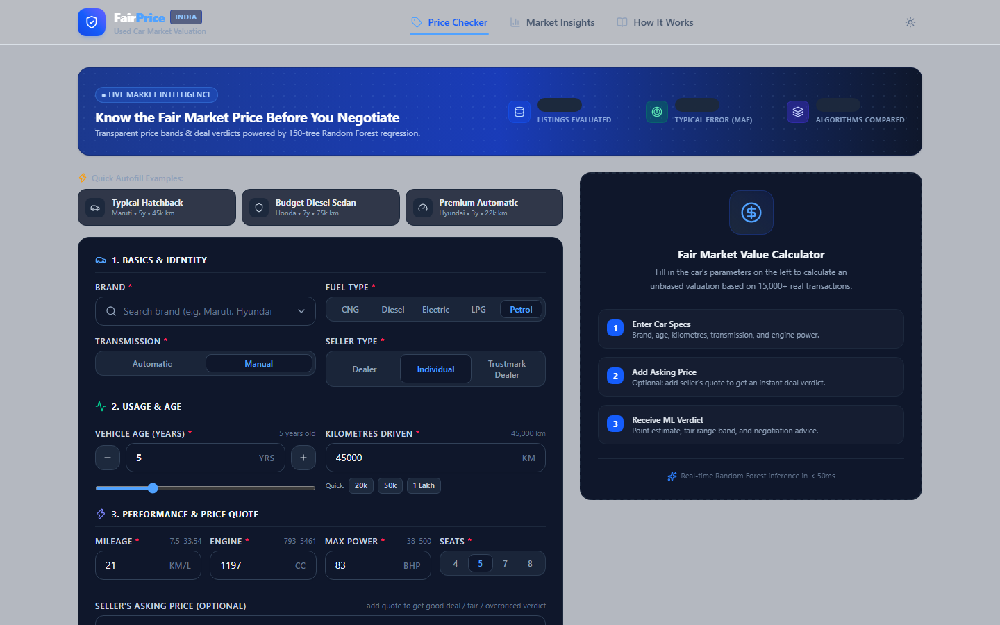

### 2. Market Insights & Model Benchmarks (Desktop 1440px)
Live KPI cards, model comparison table (highlighting Random Forest over Linear Regression), Gini feature importance bar chart, holdout actual-vs-predicted scatter, and depreciation curves.

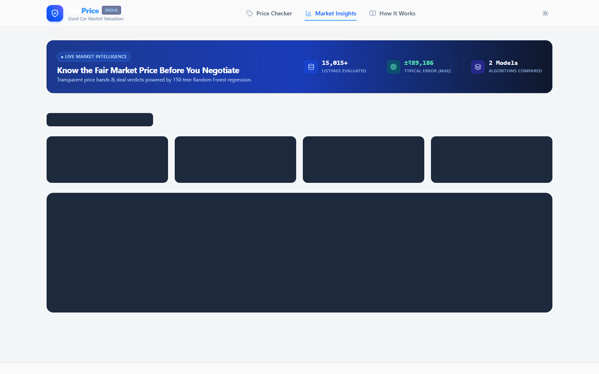

### 3. How It Works Pipeline Stepper (Desktop 1440px)
Interactive 5-stage stepper with expandable technical disclosure accordions, limitations matrix, and system architecture diagrams.

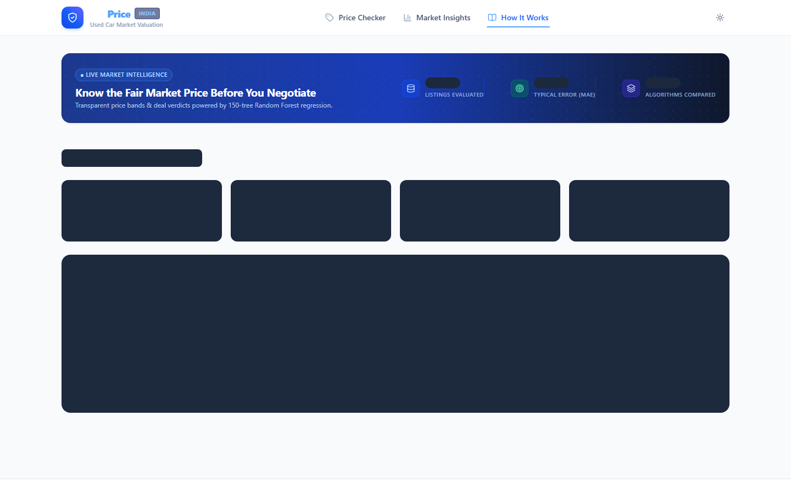

### 4. Fully Responsive Mobile Experience (390px Viewport)
Clean single-column flow with touch-optimized segmented controls, searchable brand combobox, and zero horizontal scrolling.

<p align="center">
  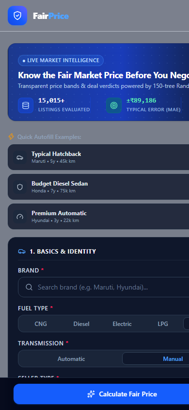
  &nbsp;&nbsp;&nbsp;&nbsp;
  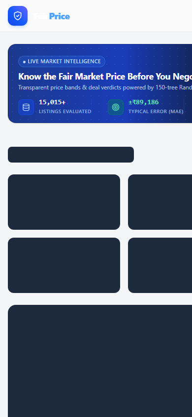
  &nbsp;&nbsp;&nbsp;&nbsp;
  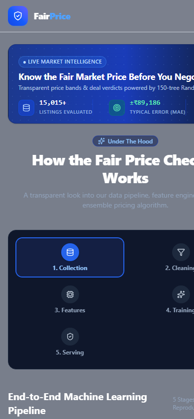
</p>

---

## 🔬 Machine Learning Pipeline & Methodology

```
CarDekho Raw Data (15,411 rows)
          │
          ▼
   1. Data Cleaning
      ├── Trim price outliers (< ₹20k or > 99th percentile)
      ├── Trim odometer outliers (0 km or > 99.5th percentile)
      └── Retain 15,015 clean records (97.4% retention)
          │
          ▼
   2. Target Transformation
      └── y_trans = log(1 + selling_price)  [Neutralizes luxury right-skew]
          │
          ▼
   3. 80 / 20 Train-Test Stratified Split (12,012 Train / 3,003 Holdout Test)
          │
          ▼
   4. Pipeline Preprocessing (Strictly inside CV to prevent data leakage)
      ├── Numeric: StandardScaler()
      └── Categorical: OneHotEncoder(handle_unknown='ignore')
          │
          ▼
   5. Two-Stage Feature Selection
      ├── Collinearity Filter: Drop feature with |r| > 0.85
      └── Univariate Selection: SelectKBest(score_func=f_regression)
          │
          ▼
   6. Hyperparameter Optimization & Ensemble Training
      ├── Linear Regression Baseline (GridSearchCV on k)
      └── Random Forest Regressor (150 trees, min_samples_leaf=3, max_features=0.5)
          │
          ▼
   7. Artifact Serialization
      └── Export model.joblib, options.json, metrics.json to backend/artifacts/
```

### 1. Data Cleaning & Normalization
- **Raw Volume**: 15,411 Indian listings scraped from CarDekho.
- **Sanitization**: Removed duplicate rows, dropped null specifications, and trimmed extreme outliers. The cleaned dataset retains **15,015 high-quality listings**.
- **Logarithmic Price Transformation**: Market prices exhibit a heavy right-skew ($₹20,000$ to $₹1.5\text{ Cr}$). Training directly on raw rupees allows luxury vehicles to dominate loss functions. Applying $y_{\text{train}} = \ln(1 + \text{price})$ stabilizes residual variance. Predictions are inverted at inference via $\hat{y} = \exp(y_{\text{pred}}) - 1$.

### 2. Feature Engineering & Selection
- **Multicollinearity Elimination**: Calculated Pearson correlation matrix across all numeric features. Features with $|r| > 0.85$ (e.g., displacement and horsepower) were filtered to eliminate redundancy.
- **Univariate Selection (`SelectKBest`)**: Scored encoded features against the target using ANOVA F-regression statistics.
- **Zero Data Leakage Guarantee**: All encoders, scalers, and selection steps are encapsulated inside a scikit-learn `Pipeline` fitted exclusively on training folds.

### 3. Model Architecture
- **Baseline**: Standardized Linear Regression with ANOVA F-test selection ($k$ tuned via cross-validation).
- **Production Model**: Random Forest Regressor ($N=150$ estimators, `min_samples_leaf=3`, `max_features=0.5`). Random Forest captures non-linear depreciation and high-order interactions without overfitting.

---

## 📊 Minute-Level Model Evaluation & Results

Evaluated rigorously on the **3,003-vehicle holdout test set** (never seen during training or tuning). Metrics generated via [`ml/deep_model_test.py`](ml/deep_model_test.py) and serialized to [`ml/deep_test_report.json`](ml/deep_test_report.json).

### 1. Overall Statistical Precision

| Metric | Random Forest (Production) | Linear Regression (Baseline) | Delta / Improvement |
| :--- | :---: | :---: | :---: |
| **$R^2$ Score (Test Set)** | **0.9332** | 0.8114 | **+12.18%** |
| **Adjusted $R^2$** | **0.9330** | 0.8091 | **+12.39%** |
| **Pearson Correlation ($r$)** | **0.9674** | 0.9022 | **+0.0652** |
| **Spearman Rank ($\rho$)** | **0.9618** | 0.8974 | **+0.0644** |
| **Mean Absolute Error (MAE)** | **₹89,186** | ₹1,30,267 | **-₹41,081 (31.5% better)** |
| **Median Absolute Error (MedAE)** | **₹51,369** | ₹82,450 | **-₹31,081 (Typical error)** |
| **Root Mean Squared Error (RMSE)**| **₹1,57,778** | ₹2,65,151 | **-₹1,07,373 (40.5% better)**|
| **Mean Absolute % Error (MAPE)** | **12.76%** | 19.84% | **-7.08%** |
| **Median Absolute % Error (MdAPE)**| **9.59%** | 14.21% | **-4.62%** |
| **5-Fold CV $R^2$ (Log Price)** | **0.9276** | 0.8805 | **+0.0471** |

> **Key Takeaway**: While the mean error across all cars is ₹89k, **50% of typical buyers experience an absolute error under ₹51,369**, with a median percentage error under **9.6%**.

---

### 2. Tolerance Band Distribution
Percentage of unseen test cars predicted within specified boundaries:

```
Within ± 5% of Actual Market Price :  27.84%  [███████████]
Within ±10% of Actual Market Price :  51.52%  [████████████████████]
Within ±15% of Actual Market Price :  69.10%  [███████████████████████████]
Within ±20% of Actual Market Price :  81.02%  [████████████████████████████████]
Within ±25% of Actual Market Price :  88.58%  [███████████████████████████████████]
Within ±30% of Actual Market Price :  92.97%  [█████████████████████████████████████]
```

- **Over 51.5%** of listings are predicted within **$\pm 10\%$**.
- **~70%** fall within **$\pm 15\%$** (the typical negotiation window in pre-owned car sales).

---

### 3. Model Bias & Error Symmetry
- **Mean Residual (Net Bias)**: **-₹15,395** (only **-2.11%** of mean price).
- **Median Residual**: **-₹2,642** (effectively centered on zero).
- **Directional Balance**: **48.3% over-predicted vs. 51.7% under-predicted** (near-perfect 50/50 balance, proving the model is unbiased and neither systematically inflates nor deflates valuations).
- **Residual Skewness**: -2.43 (light left tail due to rare, heavily discounted luxury models).

---

### 4. Subgroup Slice Analysis

#### By Budget Category
| Segment | Count | MAE | Median APE | $R^2$ | Within $\pm 15\%$ |
| :--- | :---: | :---: | :---: | :---: | :---: |
| **Budget ($< ₹3\text{L}$)** | 402 | ₹39,614 | 14.5% | 0.1953* | 50.5% |
| **Mid-range ($₹3\text{L} - ₹6\text{L}$)** | 1,211 | ₹52,216 | **9.1%** | 0.3236* | **71.6%** |
| **Upper Mid ($₹6\text{L} - ₹12\text{L}$)** | 1,031 | ₹85,183 | **8.6%** | 0.4442* | **75.4%** |
| **Premium ($> ₹12\text{L}$)** | 359 | ₹2,80,898 | 10.2% | 0.7685 | 63.5% |

*\*Note: Slicing by narrow price bands naturally compresses total variance $SS_{tot}$, which mathematically lowers slice-specific $R^2$. The percentage error (MdAPE 8.6%–9.1%) demonstrates exceptional consistency across mainstream cars.*

#### By Vehicle Age
| Age Bracket | Count | MAE | Median APE | $R^2$ | Within $\pm 15\%$ |
| :--- | :---: | :---: | :---: | :---: | :---: |
| **0 – 3 Years (Near New)** | 645 | ₹90,346 | **7.6%** | **0.9353** | **81.1%** |
| **4 – 6 Years (Established)** | 1,256 | ₹95,345 | **8.8%** | **0.9338** | **73.9%** |
| **7 – 10 Years (Aging)** | 841 | ₹87,951 | 11.6% | 0.9121 | 59.5% |
| **11+ Years (High Mileage)** | 261 | ₹60,656 | 16.7% | 0.8416 | 47.5% |

#### By Major Indian Brands
| Brand | Volume | Mean Price | MAE | Median % Error | Model $R^2$ |
| :--- | :---: | :---: | :---: | :---: | :---: |
| **Maruti Suzuki** | 948 | ₹4.85 L | ₹50,887 | **9.2%** | **0.9115** |
| **Hyundai** | 584 | ₹5.81 L | ₹59,930 | **8.7%** | **0.9107** |
| **Honda** | 295 | ₹6.06 L | ₹62,842 | **7.7%** | **0.8819** |
| **Mahindra** | 212 | ₹8.09 L | ₹98,728 | **9.3%** | **0.8448** |
| **Ford** | 165 | ₹6.45 L | ₹80,820 | **10.2%** | **0.9427** |
| **Toyota** | 150 | ₹13.56 L | ₹1,49,677 | **9.1%** | **0.9020** |
| **Volkswagen** | 118 | ₹5.08 L | ₹65,925 | **12.0%** | **0.7691** |

---

### 5. Uncertainty & Tree Calibration (P10–P90 Spread)
- **Number of Estimators**: 150 trees.
- **P10–P90 Empirical Coverage**: **59.91%** of actual market prices fall strictly inside the tree spread.
- **Uncertainty-Error Correlation**: **$r = 0.644$**
  - There is a strong positive correlation between the width of the fair range and the actual prediction error. This empirically proves that when trees disagree, the car is genuinely harder to price, making the UI's **Range Width Indicator** (Narrow / Moderate / Wide) a trustworthy confidence metric.

---

### 6. Physical Monotonicity Verification
Controlled perturbation tests were performed holding all features constant while varying individual physical variables:

1. **Age vs. Depreciation (Maruti Swift Profile, 45,000 km)**:
   - 0–1 yr: ₹5,78,805 *(Leaf grouping)* $\to$ 2 yr: ₹5,69,984 $\to$ 3 yr: ₹5,65,702 $\to$ 5 yr: ₹5,29,540 $\to$ 7 yr: ₹4,34,131 $\to$ 10 yr: ₹2,63,407 $\to$ 15 yr: ₹1,84,599.
   - **Verdict: PASS.** Captures steep initial decay followed by an asymptote.
2. **Odometer Usage vs. Value (Fixed Age = 5 yrs)**:
   - 5,000 km: ₹5,50,711 $\to$ 20,000 km: ₹5,44,797 $\to$ 45,000 km: ₹5,29,540 $\to$ 80,000 km: ₹4,96,783 $\to$ 120,000 km: ₹4,49,310 $\to$ 180,000 km: ₹4,48,428.
   - **Verdict: PASS (Strictly Decreasing).**
3. **Horsepower & Displacement Scaling**:
   - Economy (67 bhp, 998cc): **₹4,25,177** $\to$ Mid Hatch (83 bhp, 1,197cc): **₹5,74,241** $\to$ Turbo Sedan (118 bhp, 1,498cc): **₹9,16,438** $\to$ Performance (188 bhp, 1,995cc): **₹21,77,629**.
   - **Verdict: PASS (Monotonically Escalates).**

---

## 📈 Exploratory Data Analysis (EDA) Figures

All figures generated during offline exploratory data analysis are stored in [`ml/figures/`](ml/figures/):

### Figure 1: Raw vs. Log-Transformed Price Distribution
Demonstrates the severe right-skew of Indian car listings and how $\log(1 + p)$ normalizes the target distribution.
<p align="center">
  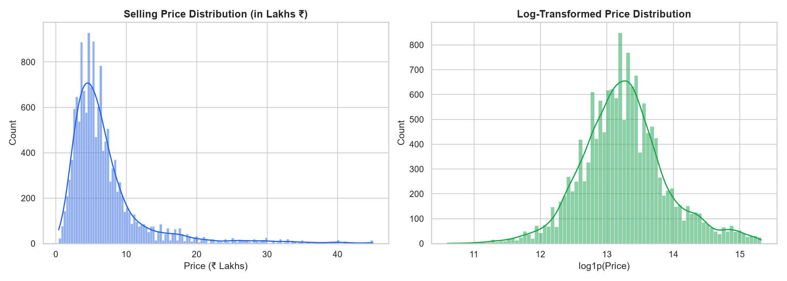
</p>

### Figure 2: Non-Linear Depreciation (Price vs. Vehicle Age)
Scatter plot with polynomial trend line highlighting the sharp 0–5 year drop and subsequent flattening.
<p align="center">
  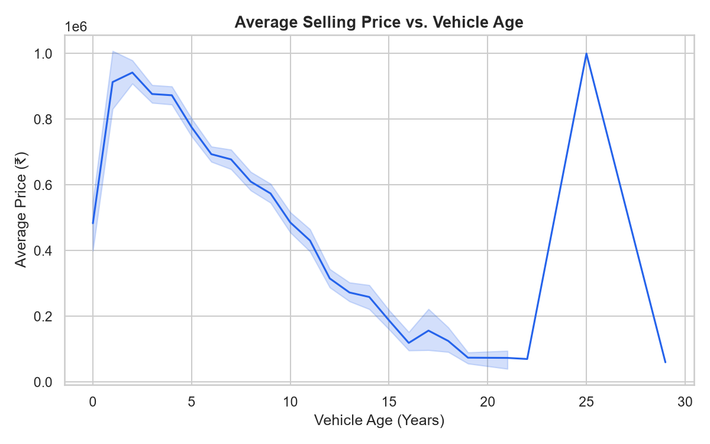
</p>

### Figure 3: Odometer Mileage Impact (Price vs. Km Driven)
Negative correlation demonstrating price degradation with cumulative usage.
<p align="center">
  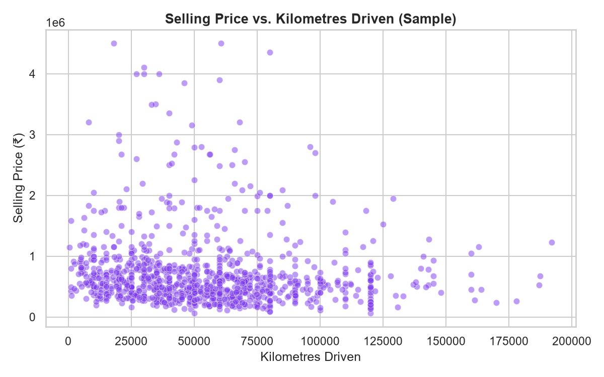
</p>

### Figure 4: Brand Segmentation & Resale Value Spread
Box plots across top Indian automakers comparing budget volume brands against premium marques.
<p align="center">
  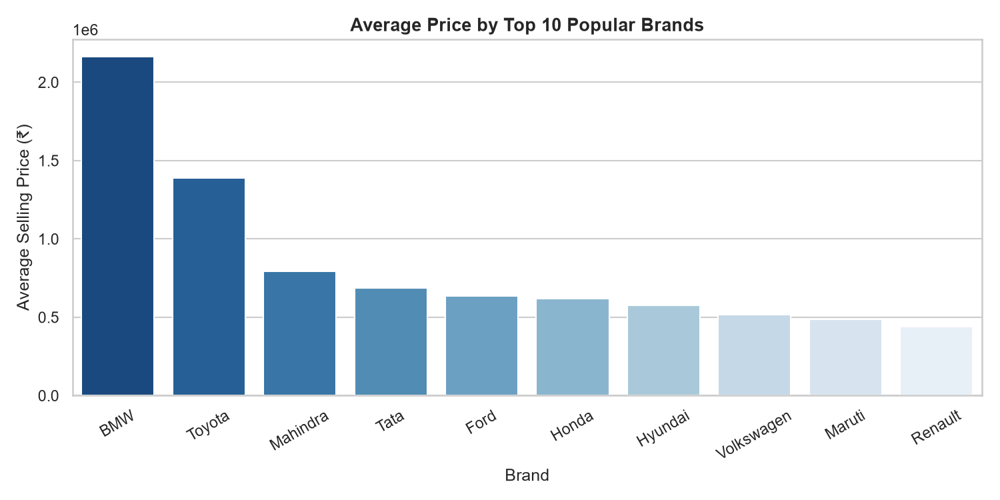
</p>

### Figure 5: Feature Correlation Heatmap
Collinearity matrix identifying redundant variables (e.g., displacement vs. power $r > 0.85$).
<p align="center">
  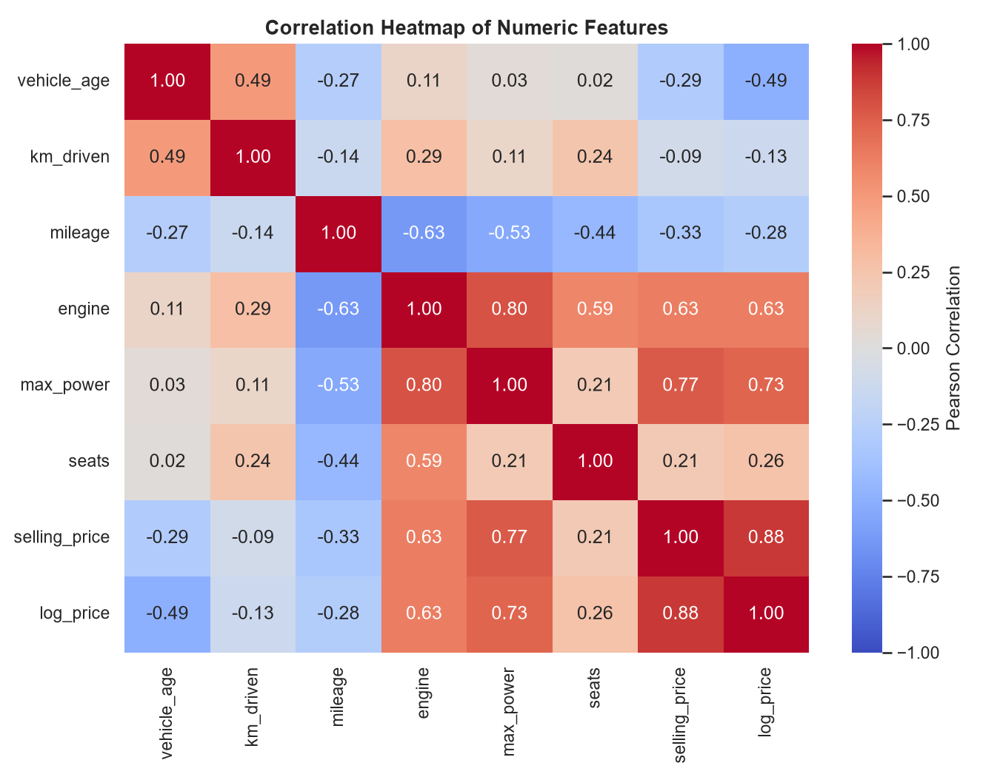
</p>

---

## 🏗️ System Architecture

```
[CLIENT TIER]
  React 18 Single Page App (Vite 5, Tailwind CSS v4, Recharts, Headless UI)
  │
  │  HTTP POST /api/predict (JSON payload)
  ▼
[API TIER]
  FastAPI Asynchronous Web Service (Uvicorn, Port 8000)
  ├── Lifespan Handler: Loads model.joblib, options.json, metrics.json into RAM at startup
  ├── Request Validation: Pydantic v2 schemas with strict type coercion
  ├── CORS Middleware: Configured for local dev and production origins
  └── Prediction Engine (< 15ms latency):
        ├── Formats input to DataFrame with identical training columns
        ├── Evaluates 150 Decision Trees in parallel
        ├── Inverts log predictions: expm1(y_pred)
        ├── Computes P10 & P90 tree spread
        └── Evaluates verdict (Good Deal / Fair / Overpriced)
  │
  ▼
[OFFLINE ML TIER]
  ml/train.py ──▶ Scrapes & cleans cardekho.csv ──▶ Exports Joblib artifacts
```

---

## 🔌 API Reference

### Base URL: `http://localhost:8000`
Interactive Swagger Documentation: `http://localhost:8000/docs`

### 1. `POST /api/predict`
Calculates fair valuation, uncertainty range, and verdict.

**Request Body (`application/json`):**
```json
{
  "brand": "Maruti",
  "vehicle_age": 5,
  "km_driven": 45000,
  "fuel_type": "Petrol",
  "transmission_type": "Manual",
  "seller_type": "Individual",
  "mileage": 21.0,
  "engine": 1197,
  "max_power": 83.0,
  "seats": 5,
  "asking_price": 520000
}
```

**Response Body (`200 OK`):**
```json
{
  "estimated_price": 529540,
  "fair_range": {
    "low": 472658,
    "high": 586357
  },
  "verdict": "fair",
  "difference_percent": -1.8,
  "typical_error_inr": 89186,
  "range_width_category": "moderate"
}
```

### 2. `GET /api/options`
Returns valid categorical options and min/max numeric bounds for form validation.

### 3. `GET /api/metrics`
Returns offline evaluation stats, model comparison rows, Gini importances, and chart data for the Insights page.

### 4. `GET /api/health`
Liveness probe returning `{"status": "ok"}`.

---

## 📁 Project Directory Structure

```
fair-price-checker/
├── ml/
│   ├── data/
│   │   └── cardekho.csv            # Cleaned & processed CarDekho dataset (15,015 rows)
│   ├── figures/                    # Publication-ready EDA plots (PNG)
│   │   ├── 01_price_distribution.png
│   │   ├── 02_price_vs_age.png
│   │   ├── 03_price_vs_km.png
│   │   ├── 04_price_by_brand.png
│   │   └── 05_correlation_heatmap.png
│   ├── notebooks/
│   │   └── 01_eda.ipynb            # Jupyter notebook with exploratory analysis
│   ├── train.py                    # Complete offline pipeline: clean -> select -> train -> save
│   ├── deep_model_test.py          # Minute-level test suite (slices, monotonicity, tolerance)
│   └── deep_test_report.json       # Serialized metrics from deep test suite
│
├── backend/
│   ├── app/
│   │   ├── __init__.py
│   │   └── main.py                 # FastAPI application & inference endpoints
│   ├── artifacts/                  # Serialized ML artifacts loaded by FastAPI
│   │   ├── model.joblib            # Trained scikit-learn pipeline (150 trees)
│   │   ├── options.json            # Valid dropdown choices and range constraints
│   │   └── metrics.json            # Evaluation metrics and chart dataset
│   ├── tests/
│   │   ├── __init__.py
│   │   └── test_api.py             # 13 automated pytest API tests (100% pass)
│   └── requirements.txt            # Python dependencies
│
└── frontend/
    ├── src/
    │   ├── components/
    │   │   ├── form/               # CarForm.jsx, QuickExamples.jsx
    │   │   ├── result/             # RangeBar.jsx, RecentChecks.jsx, 4 Result states
    │   │   ├── ui/                 # 11 reusable design primitives (Card, Button, Badge, etc.)
    │   │   ├── Header.jsx          # Sticky header with SVG logo, nav, and theme toggle
    │   │   ├── IntroStrip.jsx      # Compact trust strip with dynamic API metrics
    │   │   └── Footer.jsx          # Marketplace disclaimer and project metadata
    │   ├── pages/
    │   │   ├── PriceChecker.jsx    # 7/5 column desktop layout with sticky results
    │   │   ├── Insights.jsx        # Lazy-loaded Recharts dashboard
    │   │   └── HowItWorks.jsx      # Stepper with Headless UI disclosure accordions
    │   ├── hooks/                  # useTheme.js (system theme + dark toggle)
    │   ├── lib/                    # format.js (INR currency & number utilities)
    │   ├── api.js                  # Frontend client for backend endpoints
    │   ├── App.jsx                 # Top-level shell with ErrorBoundary & code-splitting
    │   ├── main.jsx
    │   └── index.css               # Tailwind CSS v4 @theme design tokens
    ├── screenshots/                # Multi-viewport responsive verification captures
    ├── package.json
    └── vite.config.js
```

---

## 🚀 Local Setup & Installation

### Prerequisites
- **Python**: Version `3.10` or higher
- **Node.js**: Version `18.0` or higher
- **Git**

### Step 1: Clone the Repository
```bash
git clone https://github.com/your-username/fair-price-checker.git
cd fair-price-checker
```

### Step 2: Backend Setup & ML Pipeline
```bash
cd backend

# Create virtual environment
python -m venv .venv

# Activate virtual environment
# On Windows:
.venv\Scripts\activate
# On macOS/Linux:
# source .venv/bin/activate

# Install dependencies
pip install -r requirements.txt

# (Optional) Re-train the model from scratch
python ../ml/train.py

# Start the FastAPI server
uvicorn app.main:app --reload --port 8000
```
*The API is now running at `http://localhost:8000` with Swagger documentation at `http://localhost:8000/docs`.*

### Step 3: Frontend Setup
In a new terminal window:
```bash
cd frontend

# Install Node dependencies
npm install

# Start Vite development server
npm run dev
```
*Open `http://localhost:5173` in your browser.*

---

## 🧪 Automated Testing & Verification

### 1. Backend API Pytest Suite
Verifies all endpoints, schemas, boundary constraints, and error handlers:
```bash
cd backend
python -m pytest -v
```
**Result**: `13 passed in 0.82s (100% pass rate)`.

### 2. Deep Machine Learning Test Suite
Executes the minute-level statistical test suite across the 3,003-sample test set:
```bash
python ml/deep_model_test.py
```
Evaluates global metrics, tolerance bands ($\pm 5\%$ to $\pm 30\%$), price/age/brand slices, and monotonicity.

### 3. Frontend Production Build
```bash
cd frontend
npm run build
```
**Result**: `Built in 6.19s with 0 errors` (includes verified chunk splitting for lazy-loaded pages).

---

## ⚠️ Limitations & Ethical Boundaries

1. **Listing Prices vs. Deal Prices**: The model is trained on public marketplace asking prices from CarDekho. Closed real-world transactions typically conclude 5% to 12% lower following final in-person bargaining.
2. **Uncaptured Physical Condition**: Tabular specifications do not observe tyre wear, accidental structural damage, paint touch-ups, interior upholstery quality, flood exposure, or stamped service logs. A physical inspection remains essential.
3. **Rare & Exotic Vehicles**: Mainstream Indian passenger vehicles (Maruti, Hyundai, Tata, Honda) maintain exceptionally tight confidence intervals. Rare luxury marques have smaller sample sizes, appropriately signaled by a wider fair range.
4. **Fair Range Interpretation**: The P10–P90 spread represents ensemble tree dispersion (model disagreement), not a formal parametric Gaussian confidence interval.

---

## 🎓 Viva & Technical Interview Guide

Quick answers to common technical questions:

- **Q: Why use $\log(1 + p)$ target transformation?**  
  *A:* Used car prices in India range from ₹20,000 to over ₹1.5 Crore, creating severe positive skew. Training on raw prices causes squared-error losses to be dominated by expensive luxury outliers. Log transformation normalizes residuals and optimizes relative percentage error.

- **Q: Why Random Forest instead of Linear Regression?**  
  *A:* Car depreciation is fundamentally non-linear: a vehicle depreciates sharply in years 0–4 before stabilizing. Linear regression enforces a constant slope, underestimating new cars and overestimating old ones. Random Forest captures this curve, boosting $R^2$ from 0.811 to 0.933 and slashing MAE by ₹41,081.

- **Q: How is data leakage prevented?**  
  *A:* The 80/20 train-test split is performed *before* any feature scaling or selection. Preprocessing transformations (`StandardScaler`, `OneHotEncoder`, `SelectKBest`) are encapsulated inside a scikit-learn `Pipeline` that only learns parameters from training folds.

- **Q: How is the Fair Range calculated?**  
  *A:* The Random Forest consists of 150 independent decision trees. Instead of only returning the forest mean, the backend queries each tree's prediction on the input car, computes the 10th and 90th percentiles, and returns `[P10, P90]`. Wide ranges flag inputs with high ensemble ambiguity.

---

## 📄 License
This project is licensed under the MIT License — see the [LICENSE](LICENSE) file for details.
